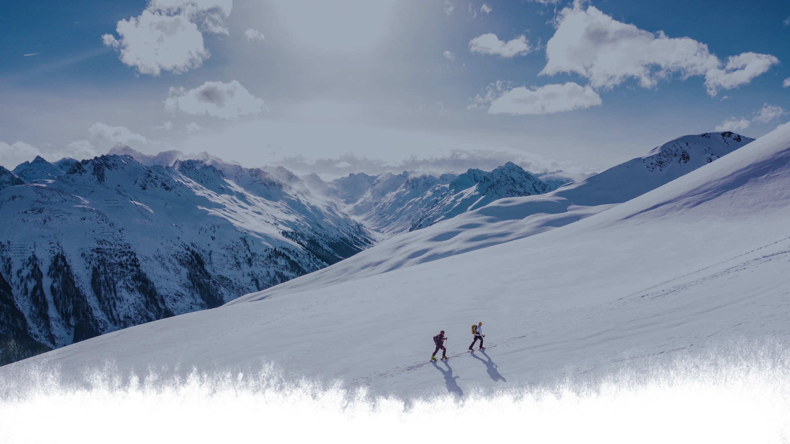

# 🏔️ Mountain Landing Page Template

> A responsive mountain-expedition landing page built with React, ready to be used as a starting point for new sites



## 📋 Table of Contents

-   [About the Project](#-about-the-project)
-   [Features](#-features)
-   [Technologies Used](#-technologies-used)
-   [Prerequisites](#-prerequisites)
-   [Installation and Setup](#-installation-and-setup)
-   [Running with Docker](#-running-with-docker)
-   [Project Structure](#-project-structure)
-   [Tests](#-tests)
-   [Contributing](#-contributing)
-   [License](#-license)

## 🎯 About the Project

**Mountain** is a one-page React landing page built by BortolettoTech as a template for mountain-expedition and outdoor-tourism businesses. It ships with a hero section, a features/differentials grid and a contact footer, so it can be restyled and dropped into a new project quickly.

### Why use this template?

-   ✅ **Component-based**: small, reusable React components (Header, Differentials, Footer, Button)
-   ✅ **Responsive**: adapts from desktop down to mobile
-   ✅ **Ready-made sections**: hero banner, feature cards and a contact footer with social links
-   ✅ **Easy to theme**: colors, fonts and spacing centralized per component stylesheet
-   ✅ **Containerized**: ships with a Docker image for instant deployment

## 🚀 Features

-   **Hero banner** with a full-screen background image and a call-to-action button
-   **Sticky navigation** linking to each section with smooth scrolling
-   **Feature cards** (`Differentials`) rendered from a single data array — add or remove cards by editing one list
-   **Contact footer** with quick links and social icons (GitHub, LinkedIn)
-   **Template badge** linking back to this repository's source

## 🛠 Technologies Used

-   **React 17** - UI library
-   **Create React App** - build tooling
-   **React Icons** - icon set
-   **CSS3** - styling and responsive layout
-   **Google Fonts** - typography (Lato)
-   **Docker & Nginx** - containerized static hosting

## 📋 Prerequisites

To run the project locally, you need one of:

-   **Node.js** ([Download](https://nodejs.org/en/)) and **npm** to run it with the dev server
-   **Docker** ([Download](https://docs.docker.com/get-docker/)) to run it containerized

## 🚀 Installation and Setup

### 1. Clone the Repository

```bash
git clone https://github.com/bortolettojoaog/landing-page_mountain.git
cd landing-page_mountain
```

### 2. Install Dependencies

```bash
npm install
```

### 3. Run the Application

```bash
npm start
```

The application will be available at: `http://localhost:3000`

## 🐳 Running with Docker

### 1. Build the Image

```bash
docker build -t landing-page-mountain .
```

### 2. Run the Container

```bash
docker run -d -p 8080:80 --name landing-page-mountain landing-page-mountain
```

The application will be available at: `http://localhost:8080`

## 📁 Project Structure

```
src/
├── App.jsx                        # Page composition and differentials data
├── components/
│   ├── header/                    # Hero section, navigation and template badge
│   ├── differentials/             # Feature cards grid
│   ├── differential/              # Single feature card
│   ├── footer/                    # Contact footer and social links
│   └── button/                    # Shared button component
└── index.js
public/
├── images/                        # Hero background and logo
├── favicon.svg
└── manifest.json
nginx/
└── default.conf                   # Nginx config used by the Docker image
```

## ✔️ Tests

<h1 align="center">
    
</h1>

## 🤝 Contributing

Contributions are welcome! To contribute:

1. Fork the project
2. Create a branch for your feature (`git checkout -b feature/new-feature`)
3. Commit your changes (`git commit -m 'Add new feature'`)
4. Push to the branch (`git push origin feature/new-feature`)
5. Open a Pull Request

## 📄 License

This project is under the MIT license. See the [LICENSE](LICENSE) file for more details.

---

<div align="center">
  <p>Made with ❤️ by <strong>João Guilherme Bortoletto</strong></p>
  <p><a href="https://www.linkedin.com/in/bortolettojoaog/">See my LinkedIn</a></p>
  <p>⭐ If this project was helpful, consider giving it a star!</p>
</div>
